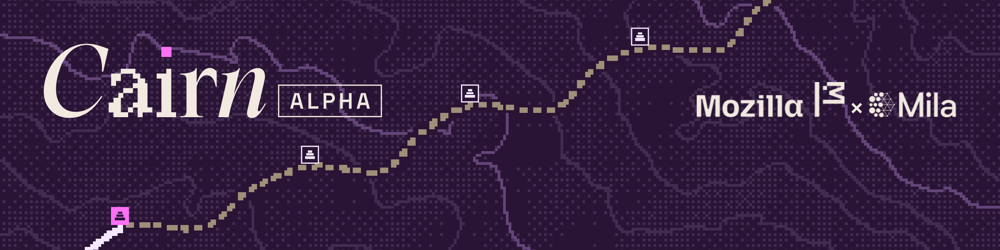

<h1></h1>

**The sovereign, open source AI stack.**

Your organization must be able to adopt AI on its own terms: safely, easily and
cost-effectively. The models are not the problem. Deploying and running them is.

Cairn is an open source AI stack that an organization installs and operates on
infrastructure that it controls.

- **Your data and your policies stay on your infrastructure.** Everything runs
  on infrastructure that you control. You can inspect and replace each
  component.
- **Open source, without the assembly.** A tested stack. You install, upgrade
  and operate it from its documentation.
- **You own your capacity and your choices.** AI runs on infrastructure that
  you own or share. Costs are predictable, and you do not depend on one
  vendor.

### Our approach to building Cairn

- **Tested open source components.** We specify what each layer must do. We
  test existing open source components against that specification. Then we
  select and integrate the best fit.
- **Replaceable by contract.** We publish the interface contracts that each
  component must satisfy. A component that satisfies them can replace another
  one without rework.
- **Your teams keep their tools.** Teams keep the chat assistants and coding
  agents that they use now. They connect these tools to one API, on the
  compute of your organization.
- **Composition, not creation.** We write the code that connects components,
  not new components. Where no suitable open source component exists, we
  publish a specification.

**The Alpha release is coming soon.** Go to [opencairn.ai](https://opencairn.ai)
to learn more.

Contact us at [bonjourhi@opencairn.ai](mailto:bonjourhi@opencairn.ai).

A research collaboration between [Mozilla](https://www.mozilla.org/) and [Mila](https://mila.quebec/en).
